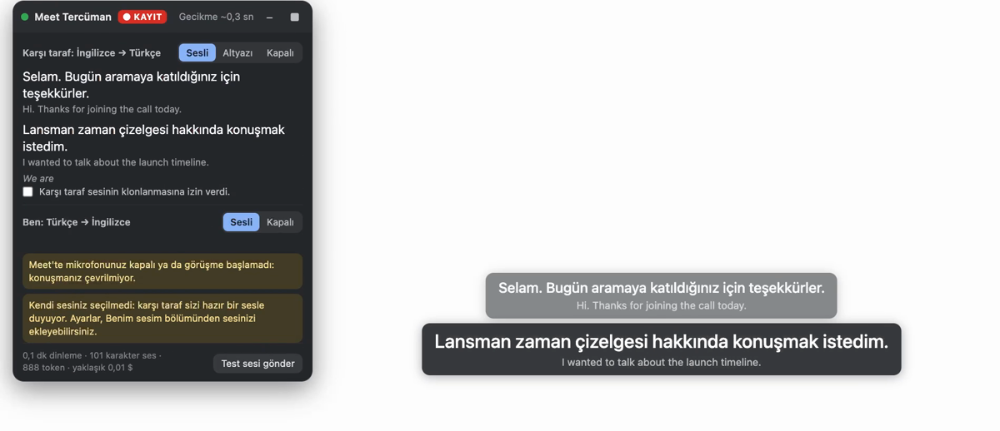

<div align="center">

# Meet Interpreter

### Live two-way speech translation for Google Meet

They speak English and you hear Turkish. You speak Turkish and they hear English, in your own voice. A Chrome extension with no backend: the keys stay in your browser.


<table>
  <tr><td><b>Languages</b></td><td>20, English and Turkish by default</td></tr>
  <tr><td><b>Modes</b></td><td>Voice, subtitles only or off, for each direction</td></tr>
  <tr><td><b>Delay</b></td><td>About 1.5 s after each sentence, measured in a real call</td></tr>
  <tr><td><b>Backend</b></td><td>None</td></tr>
  <tr><td><b>Interface</b></td><td>English or Turkish</td></tr>
</table>

<br>



</div>

---

## Features

- Listens to the call through Chrome tab capture and to you through your microphone, transcribes both sides with ElevenLabs Scribe v2 Realtime, translates with Claude (or for free, see below) and speaks the result with ElevenLabs text to speech.
- Your translated voice goes into the call in place of your microphone. Meet keeps working as usual, and muting in Meet stops everything that would reach the call.
- A mode for each direction: spoken translation, subtitles only (no speech credits used) or off, switchable mid-call from the popup or the panel on the page.
- In voice mode you hear only the translation; their own voice is muted. In subtitles-only mode and with translation off you hear them normally.
- Subtitles like a film's, low in the Meet window above Meet's controls: the translation in large type with the original under it. They move above Meet's own captions when those are on, and never take a click.
- Your own voice clone, recorded on the settings page. The other person's voice is cloned only after you confirm they agreed, and the clone is deleted when the call ends.
- A panel with both sides' subtitles, the live delay and a usage counter with an estimated cost.
- Optional call recording: the Meet tab's picture with both sides' audio, saved as MP4 on this computer only.
- Echo guard, a speaker mode for calls without headphones, automatic reconnects, and Meet's microphone followed automatically.

> **Read this first.**
> - The Turkish voice starts about 1.5 s after the other person finishes a sentence. 0.7 s of that is speech recognition waiting for silence to know the sentence ended. In a long turn, finished sentences are translated while the speaker keeps going. Settings can shorten the wait to 0.5 s, at the cost of a long sentence being split now and then.
> - Free translation through Chrome's built-in translator is literal: "saat üç" comes out as "15.00 on Friday". Claude gives natural sentences.
> - Two Meet participants on the same computer garble each other's audio, because Meet's adaptive audio and Chrome's echo cancellation treat them as one room. Test with a second device or a second person.
> - Tested in real Meet calls with two and three participants, and automatically in Chromium against a mock Meet call. Meet's page changes over time, so try a call before an important meeting.
> - Group calls work, but every remote voice comes through one translation voice.
> - Cloning someone's voice needs their consent, under ElevenLabs' terms and data protection law.

---

## How it works

```text
Meet tab audio  -> Scribe (their language) -> Claude or free -> ElevenLabs -> your headphones and the subtitle bar
your microphone -> Scribe (your language)  -> Claude or free -> ElevenLabs -> the call, in place of your mic
```

| Part | Where it runs | What it does |
| --- | --- | --- |
| `src/content/page-hook.js` | Meet's page | Swaps the microphone track on Meet's `RTCRtpSender` for the translation track, mirrors Meet's mute |
| `src/content/bridge.js` | Content script | Connects the page with the engine, shows the panel and the subtitle bar |
| `src/content/subtitle-bar.js` | Content script | The subtitles low in the Meet window |
| `src/offscreen/engine.js` | Offscreen document | Tab capture, microphone, speech recognition, translation, speech, voice clone, recording |
| `src/offscreen/stt.js` | Offscreen document | Scribe v2 Realtime client: reconnects, keeps audio while reconnecting, recovers a segment the server never commits |
| `src/offscreen/free-translator.js` | Offscreen document | Free translation: tries free services from the best down |
| `src/background/service-worker.js` | Service worker | Starts and stops sessions, keeps state for the popup |

---

## Free translation

Choose **Free** as the translation model in the settings and no Anthropic key is needed. The extension tries free services from the best quality down and moves to the next one by itself when a service runs out of quota, hits a rate limit, is slow or fails. The page never shows which one translated.

| Order | Service | Free allowance | Needs |
| --- | --- | --- | --- |
| 1 | DeepL API Free | 500,000 characters a month | Your free DeepL key |
| 2 | Mistral (`mistral-medium-latest`) | Free plan with rate limits | Your free Mistral key; turn off training on your data in Mistral's privacy settings |
| 3 | Groq `openai/gpt-oss-120b` | Daily request and token limits per model | Your free Groq key |
| 4 | Groq `qwen/qwen3.8-27b` | Its own daily limits | The same Groq key |
| 5 | Chrome's built-in translator | No limit, runs on your computer | Chrome 138 or newer on desktop |

- With no keys at all, Chrome's translator does the work. Its language packs download once, after a click: the settings page has a button for it, and the popup's Start button does it too.
- Keys are optional and belong to each person, because free quotas are per account. A key built into the extension could be copied out of it, and everyone would share one quota.
- Gemini is left out: on its free tier Google may use what you send to improve its products, and people may read it.
- Speech recognition and speech still use ElevenLabs, so an ElevenLabs key is always needed.

---

## Requirements

- Chrome 116 or newer (or another Chromium browser); 138 or newer for free translation without keys
- Node.js 18 or newer, to build
- An ElevenLabs API key (voice cloning needs a paid plan), and an Anthropic API key unless you choose free translation
- Headphones

---

## Run Locally

### Windows

Set up WSL first with this guide: https://x.com/UfukDegen/status/1944066889346429338, then follow the macOS steps inside WSL and load the `dist` folder from `\\wsl$\` in Chrome.

### macOS

```bash
git clone https://github.com/UfukNode/meet-interpreter.git
cd meet-interpreter
npm install
npm run build
```

```text
Built dist/
```

Open `chrome://extensions`, turn on Developer mode, choose **Load unpacked** and pick the `dist` folder. The settings page opens by itself; the full walkthrough, in Turkish, is in [KURULUM.md](KURULUM.md). After pulling changes, run `npm run build` again and press reload on the extension.

---

## Tests

```bash
npm test            # unit tests: audio, sentences, echo guard, ordering, speech recognition protocol, settings
npm run test:e2e    # builds, loads the extension into Chromium and drives a mock Meet call
npm run test:api    # live check of every API with latency numbers (keys in .env)
npm run test:free   # live check of DeepL, Mistral and Groq free plans (their keys in .env)
node test/meet/mock-call-demo.mjs   # both directions with the real ElevenLabs, recorded by the extension
```

- The end-to-end test needs no keys: besides the connection checks it runs a full translation round trip against a local stand-in for the ElevenLabs and Anthropic APIs (`test/e2e/mock-api.mjs`, reached through a local proxy). With keys in `.env` it repeats the round trip against the real APIs.
- Test speech is made with the macOS `say` command and ffmpeg, so the audio tests run on macOS.
- For a real call there is an opt-in debug copy: with `localStorage['meet-tercuman-debug'] = '<port>'` set on the Meet page and `node test/meet/debug-sink-server.mjs <port>` running, the extension copies the exact audio it sends to speech recognition, the transcripts and the recording to `127.0.0.1`.

---

## Security

- No backend, no analytics and no remote code: everything ships inside the extension.
- API keys are kept in `chrome.storage.local` and sent only to the service they belong to: `api.elevenlabs.io`, `api.anthropic.com`, and DeepL, Mistral or Groq when you add their keys.
- The script inside Meet's page makes no network requests. Audio reaches it through a private `MessagePort`.
- Nothing reaches the call while Meet shows you as muted, while translation to them is off, or before the call has started.
- The other person's voice is cloned only after you tick the consent box, and the clone is deleted after the call unless you change that setting.
- Recordings stay in the extension's storage on your computer until you save or delete them.
- The debug copy is off unless you set its flag on the Meet page, and it only ever sends to `127.0.0.1`.

---

## Costs

The panel counts what a call uses and estimates the cost from list prices: Scribe v2 Realtime is $0.39 an hour per active direction, Flash v2.5 and v4 Turbo speech is $0.04 per 1,000 characters, and Claude is billed per token (Haiku 5.5 is the cheapest). Subtitles-only mode makes no speech at all, and free translation costs nothing.
