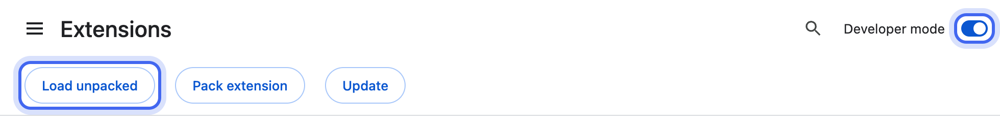
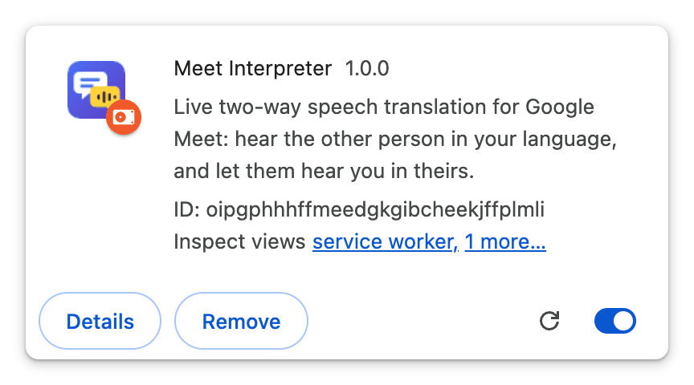
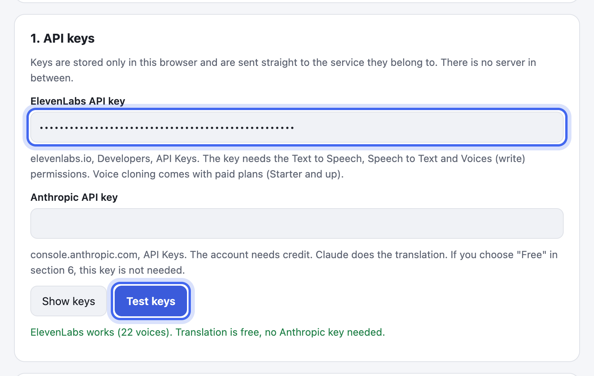
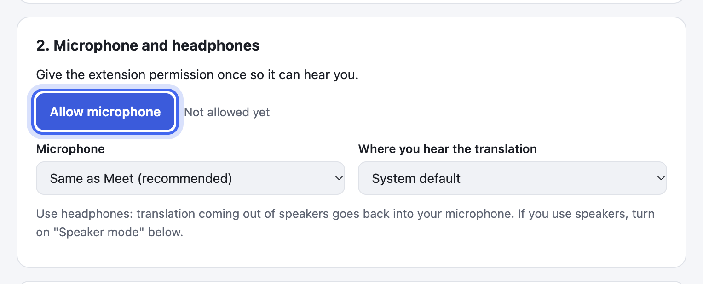
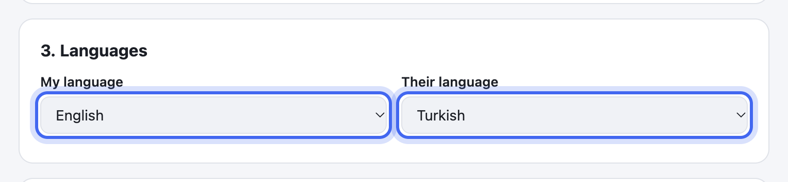
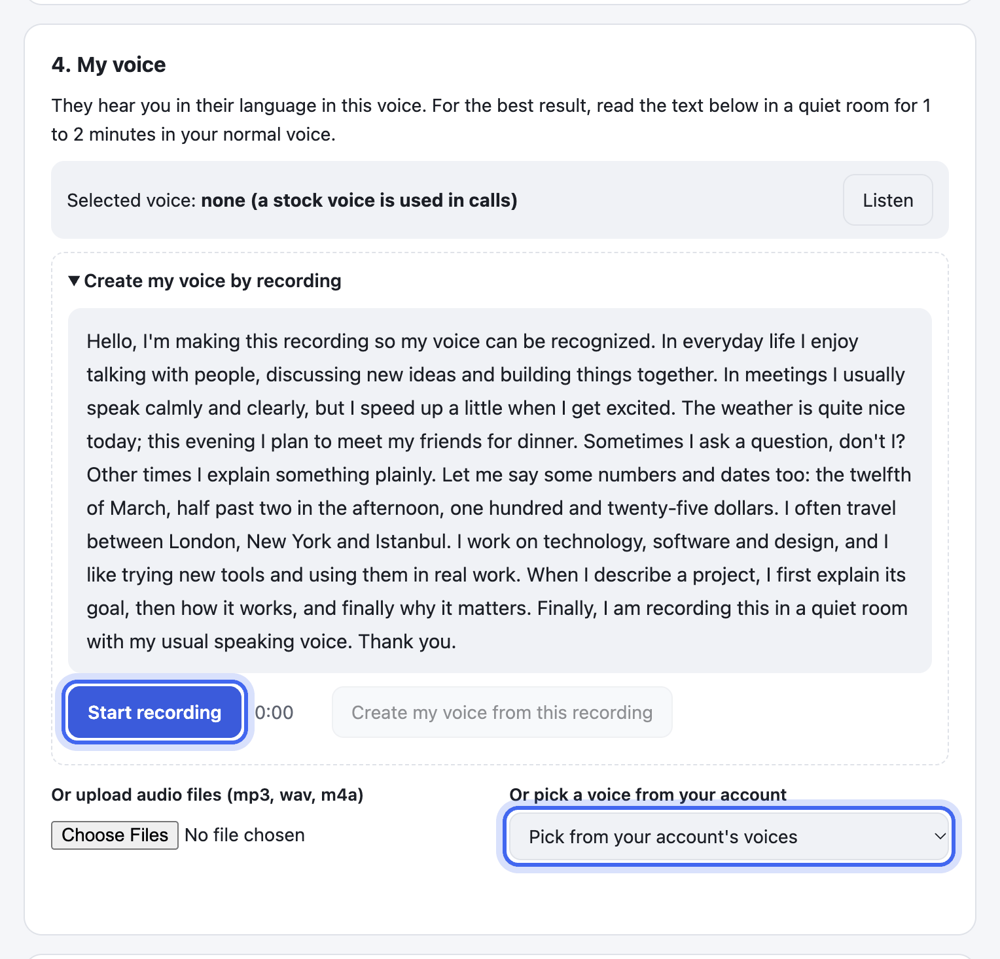
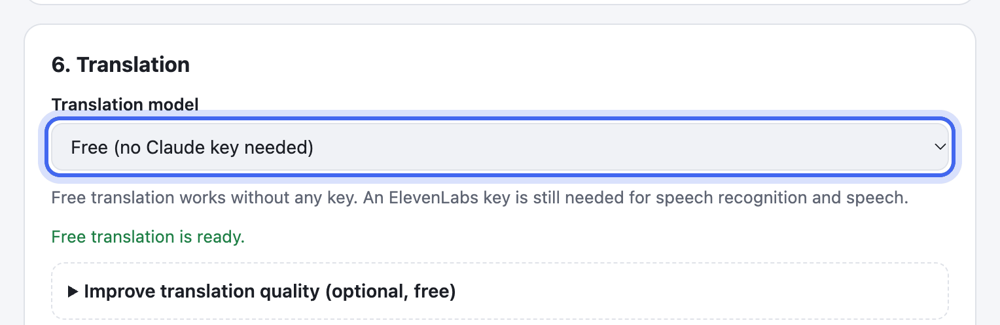
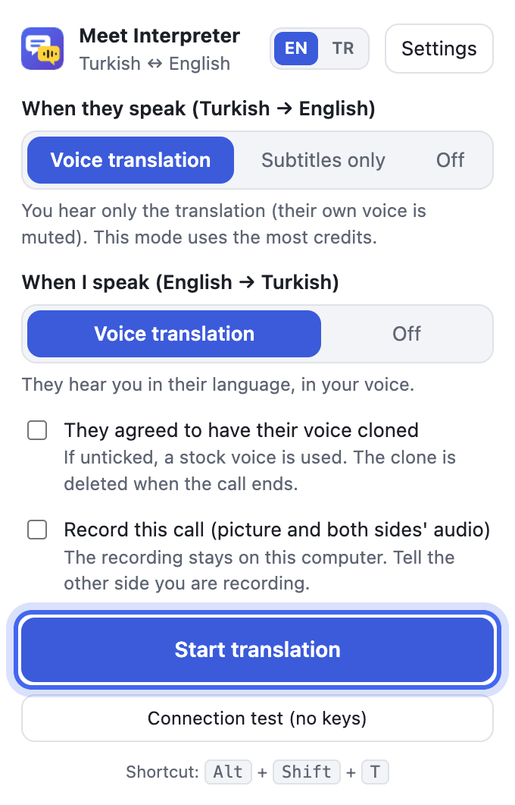
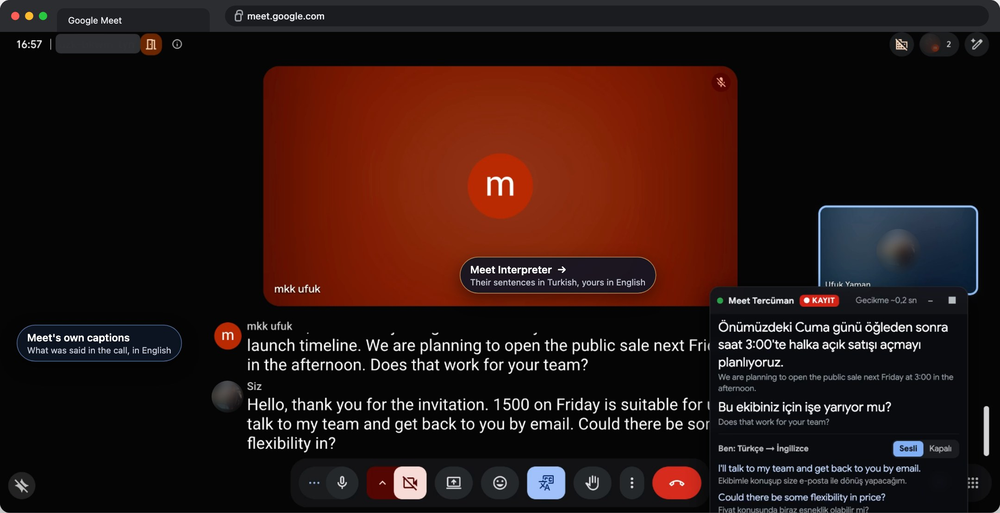

<div align="center">

# Meet Interpreter setup

**English** · [Türkçe](SETUP.tr.md)

From the download to your first translated call in ten steps.

</div>

---

## What you need

| Requirement | Notes |
| --- | --- |
| **Chrome 116 or newer** | Or another Chromium browser such as Edge or Brave. Free translation needs Chrome 138 or newer |
| **An ElevenLabs account** | For speech recognition and the voices. The free plan is enough to start; your own voice clone needs Starter or higher ([plans](https://elevenlabs.io/pricing)) |
| **Headphones** | So the translation you hear does not go back into your microphone |

Nothing else: the extension has no server, and your keys stay in your browser.

---

## 1. Download it from GitHub

On the [project page](https://github.com/UfukNode/meet-interpreter), click the latest release under **Releases** on the right. Under **Assets**, click **meet-interpreter.zip**.

<p>


</p>

Or download it straight away: [meet-interpreter.zip](https://github.com/UfukNode/meet-interpreter/releases/latest/download/meet-interpreter.zip).

## 2. Unzip it

- **macOS:** double-click the zip in Downloads.
- **Windows:** right-click it and choose **Extract All**.

You get a folder called **meet-interpreter**. Leave it where it is: Chrome runs the extension from this folder, so deleting or moving it removes the extension.

## 3. Load it into Chrome

1. Type `chrome://extensions` in the address bar and press Enter.
2. Turn on **Developer mode** at the top right.
3. Click **Load unpacked** and choose the **meet-interpreter** folder.



The extension's card appears, and its settings page opens by itself.



Pin it so its button is always in sight: click the puzzle piece next to the address bar, then the pin next to Meet Interpreter.

## 4. Get an ElevenLabs API key

1. Sign up or sign in at [elevenlabs.io](https://elevenlabs.io).
2. Open [Developers › API Keys](https://elevenlabs.io/app/developers/api-keys) and click **Create Key**.


3. Give the key a name, keep **Restrict Key** on, and set **Text to Speech** and **Speech to Text** to **Access**.
4. Scroll down, set **Voices** to **Write** (your own voice clone needs it) and click **Create Key**.

<p>


</p>

5. Click **Copy to Clipboard**. ElevenLabs shows the key only this once.


## 5. Paste the key

In the extension's settings, under **1. API keys**, paste the key into **ElevenLabs API key** and click **Test keys**. A green line means it works.



## 6. Microphone and languages

- Under **2. Microphone and headphones**, click **Allow microphone** and allow it in the box Chrome shows.



- Under **3. Languages**, pick your language and theirs. There are 20, and any two of them work both ways.



## 7. Your own voice (optional)

They hear your translation in this voice. Under **4. My voice**, click **Start recording**, read the text aloud for 1 to 2 minutes in a quiet room in your normal voice and click **Finish recording**. Then click **Create my voice from this recording**, and **Listen** to check it. A voice you already have in ElevenLabs can be picked on the right instead. Skip this step and they hear you in a ready-made voice.



## 8. Translation: free or Claude

Under **6. Translation**, set **Translation model** to **Free**. No key is needed: Chrome's own translator does the work and gets itself ready the first time ("Free translation is ready.").



- **Better free quality:** open **Improve translation quality** and add a free key from [DeepL API Free](https://www.deepl.com/pro-api), [Mistral](https://console.mistral.ai) or [Groq](https://console.groq.com/keys). The extension uses the best one that answers and skips one whose quota runs out. Mistral's free plan uses your text for training by default; turn that off in its console's privacy settings.
- **Claude:** pick a Claude model and paste an Anthropic key from [Claude Console › API keys](https://platform.claude.com/settings/keys) under **1. API keys**. The account needs credit.

## 9. Start it in a call

Join a Google Meet call, click the extension's button, choose the modes and click **Start translation** (or press Alt + Shift + T).



Choose the modes with the credits in mind:

| When they speak | You get | ElevenLabs credits |
| --- | --- | --- |
| **Voice translation** | Their words in your language, spoken | The most |
| **Subtitles only** | No voice: their own voice, and the translation as text | Far fewer |
| **Off** | Their own voice, nothing translated | None |

| When you speak | They get | ElevenLabs credits |
| --- | --- | --- |
| **Voice translation** | Your words in their language, in your voice | Yes |
| **Off** | Your real voice | None |

- If they agree, tick **They agreed to have their voice cloned**: after about 45 seconds of their speech you hear the translation in a voice close to theirs. The clone is deleted when the call ends.
- **Record this call** saves the Meet tab's picture and both sides' audio as an MP4 on this computer. Tell them you are recording.
- If the Meet tab was open before you installed the extension, reload it once (F5).

## 10. Talk

A small **Meet Interpreter** button shows at the bottom left of the Meet window. Click it for the panel: both sides' sentences in both languages, the delay and what the call has used so far. Their translation also shows as subtitles low in the Meet window. Leaving the call stops the translation by itself.



---

## Try it alone

1. Start a new meeting in Meet on the computer, put on headphones and start the extension.
2. Join the same meeting from your phone, with its volume down or its own headphones on.
3. Speak their language to the phone, or play a video in it: the computer speaks it in your language.
4. Speak your language to the computer: the phone hears it in theirs.

Two Meet participants on the same computer garble each other's audio, so use a second device.

## Save credits

- **Subtitles only** makes no speech, which is most of the cost.
- While Meet's microphone stays off, your side's speech recognition rests.
- Leaving the call stops the translation within 30 seconds; leaving Meet or closing the tab stops it at once.
- The panel shows the minutes, characters and estimated cost of the call as it goes.

## If something goes wrong

| What you see | What to do |
| --- | --- |
| "Manifest file is missing or unreadable" | The wrong folder was chosen. Choose the one with manifest.json inside: the meet-interpreter folder from the zip, or dist if you built it yourself |
| "Reload the Meet tab once (F5) and try again." | The extension was installed after the tab opened. Press F5 |
| "The extension has no microphone permission." | Settings, **Allow microphone** |
| They do not hear me | Is your microphone on in Meet? If the small button shows a !, open the panel and read the note. Try **Send test sound** |
| I hear my own translation | Use headphones, or turn on **Speaker mode** in the settings |
| The delay feels long | Pick Claude Haiku 5.5 as the translation model and set **Silence that ends a phrase** to 0.5 s |
| The translation stopped by itself | The panel stays open and says why, a used-up ElevenLabs quota for example. Fix it, then start again from the extension's button |

## Update

Download the new release's zip, replace the contents of your meet-interpreter folder with it and press reload on the extension's card in `chrome://extensions`. Your settings and voice stay.

## Build it from source

```bash
git clone https://github.com/UfukNode/meet-interpreter.git
cd meet-interpreter
npm install
npm run build
```

Then choose the `dist` folder in step 3. On Windows, build inside WSL ([guide](https://x.com/UfukDegen/status/1944066889346429338)).
