<div align="center">

# Meet Tercüman kurulumu

[English](SETUP.md) · **Türkçe**

İndirmeden ilk çevrilen görüşmeye on adım. Rehber videosundaki adımların aynısı.

</div>

---

## Gerekenler

| Gereksinim | Açıklama |
| --- | --- |
| **Chrome 116 veya üstü** | Ya da Edge, Brave gibi Chromium tabanlı bir tarayıcı. Ücretsiz çeviri için Chrome 138 veya üstü |
| **ElevenLabs hesabı** | Ses tanıma ve sesler için. Başlamak için ücretsiz plan yeter; kendi ses klonun için Starter veya üstü plan gerekir ([planlar](https://elevenlabs.io/pricing)) |
| **Kulaklık** | Duyduğun çeviri mikrofonuna geri girmesin diye |

Başka bir şey gerekmez: eklentinin sunucusu yok, anahtarların tarayıcında kalır.

---

## 1. GitHub'dan indir

[Proje sayfasında](https://github.com/UfukNode/meet-interpreter) sağdaki **Releases** bölümünden son sürüme tıkla. **Assets** altında **meet-interpreter.zip** dosyasına tıkla.

<p>
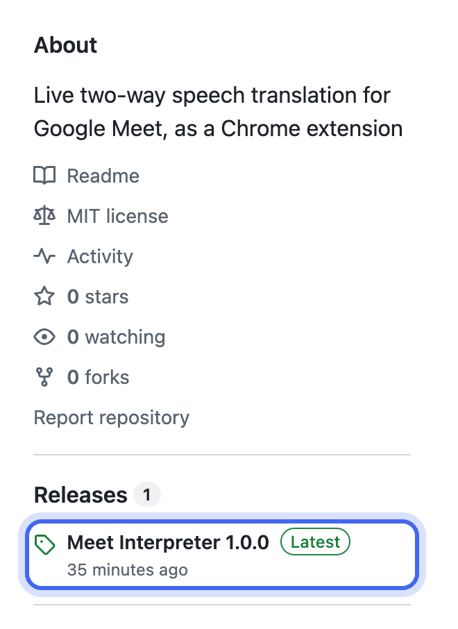
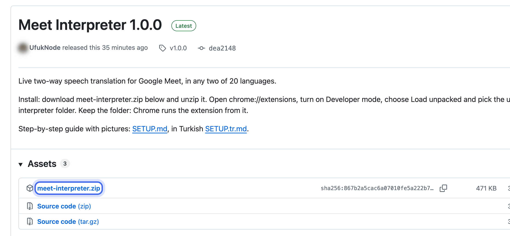
</p>

Doğrudan da indirebilirsin: [meet-interpreter.zip](https://github.com/UfukNode/meet-interpreter/releases/latest/download/meet-interpreter.zip).

## 2. ZIP'i aç

- **macOS:** İndirilenler'deki ZIP'e çift tıkla.
- **Windows:** ZIP'e sağ tıkla, **Tümünü ayıkla**'yı seç.

**meet-interpreter** adında bir klasör çıkar. Klasörü silme ya da taşıma: Chrome eklentiyi bu klasörden çalıştırır, klasör giderse eklenti de gider.

## 3. Chrome'a yükle

1. Adres çubuğuna `chrome://extensions` yaz ve Enter'a bas.
2. Sağ üstten **Geliştirici modu**nu aç.
3. **Paketlenmemiş öğe yükle** düğmesine bas ve **meet-interpreter** klasörünü seç.

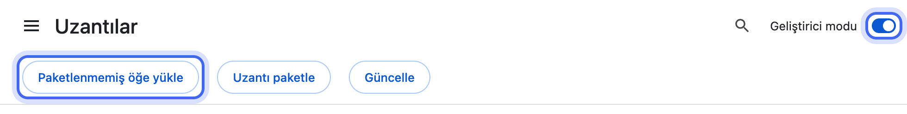

Eklentinin kartı çıkar, ayarlar sayfası da kendiliğinden açılır.

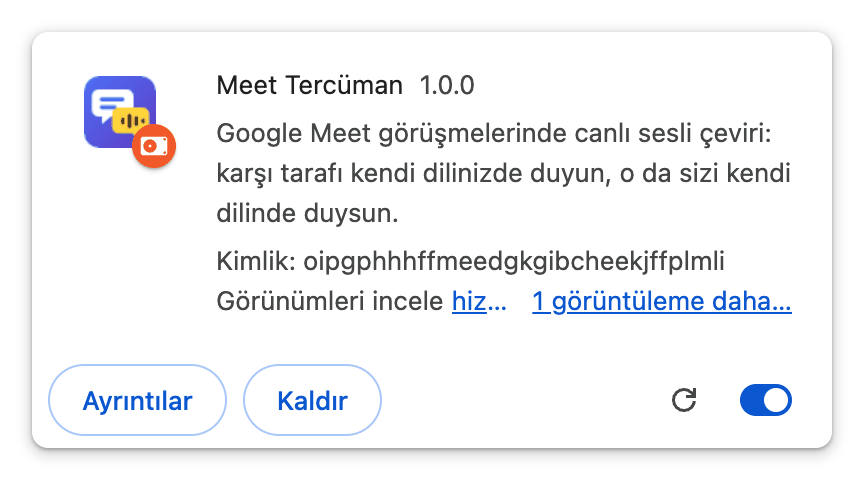

Simgesi hep görünsün diye sabitle: adres çubuğunun yanındaki yapboz simgesine, sonra Meet Tercüman'ın yanındaki raptiyeye tıkla.

## 4. Türkçeye geç

Ayarlar İngilizce açılır. Sağ üstteki **TR** düğmesine bas. Bu rehberdeki düğme adları Türkçe arayüze göredir.

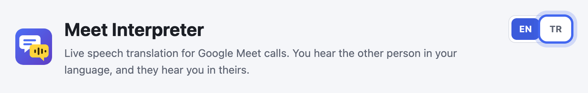

## 5. ElevenLabs anahtarı al

1. [elevenlabs.io](https://elevenlabs.io) adresinde hesap aç ya da giriş yap.
2. [Developers › API Keys](https://elevenlabs.io/app/developers/api-keys) sayfasını aç ve **Create Key** düğmesine bas.

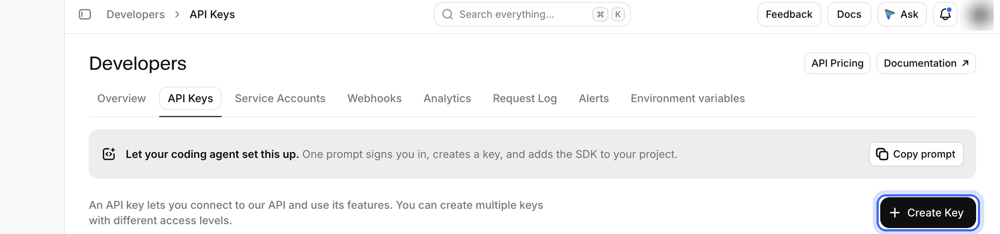

3. Anahtara bir ad ver, **Restrict Key** açık kalsın, **Text to Speech** ve **Speech to Text** satırlarını **Access** yap.
4. Aşağı kaydır, **Voices** satırını **Write** yap (kendi ses klonun için gerekir) ve **Create Key** düğmesine bas.

<p>
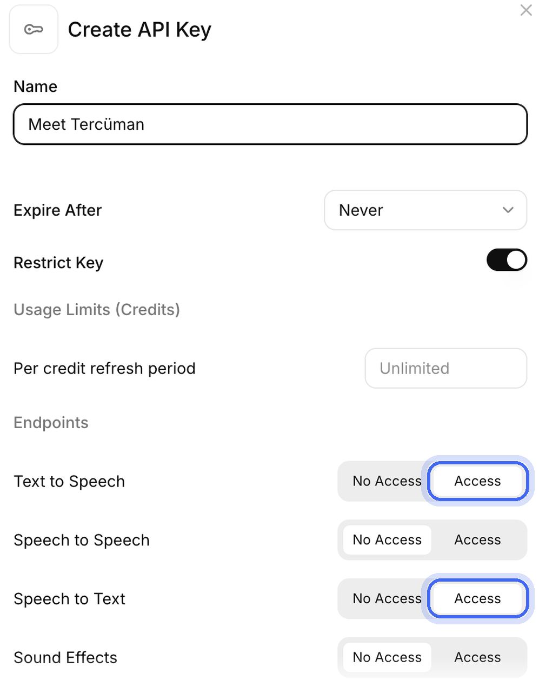
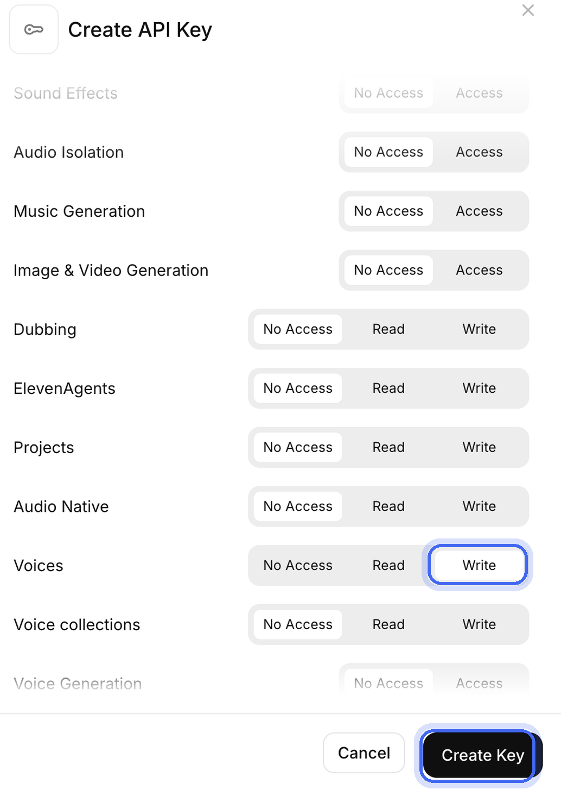
</p>

5. **Copy to Clipboard** düğmesine bas. ElevenLabs anahtarı yalnızca bu sefer gösterir.

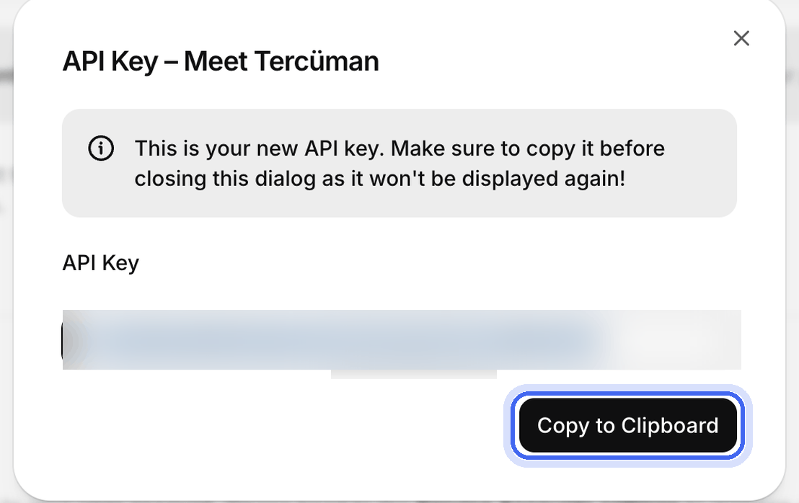

## 6. Anahtarı yapıştır

Ayarlarda **1. API anahtarları** bölümünde anahtarı **ElevenLabs API anahtarı** kutusuna yapıştır ve **Anahtarları test et** düğmesine bas. Yeşil yazı çıkarsa tamamdır.

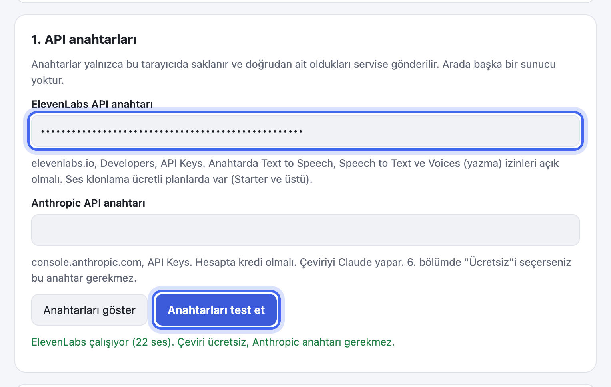

## 7. Mikrofon, diller ve kendi sesin

- **2. Mikrofon ve kulaklık** bölümünde **Mikrofon iznini ver** düğmesine bas, Chrome'un sorduğu kutuda izin ver.

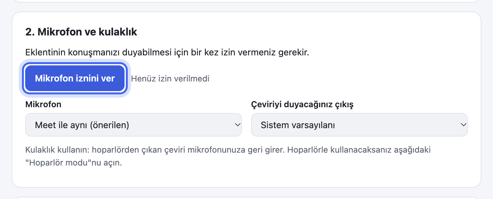

- **3. Diller** bölümünde kendi dilini ve karşı tarafın dilini seç. 20 dil var, istediğin ikisi iki yönde de çalışır.

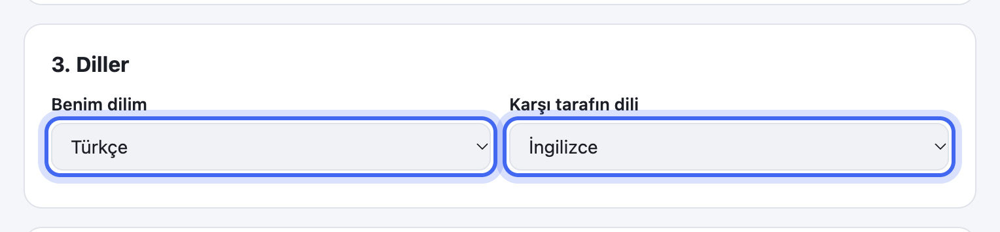

- **4. Benim sesim** bölümü isteğe bağlı: karşı taraf çevirini bu sesle duyar. **Kaydı başlat** düğmesine bas, metni sessiz bir odada normal sesinle 1 ile 2 dakika arası oku ve **Kaydı bitir** de. Sonra **Bu kayıttan sesimi oluştur** de ve **Dinle** ile kontrol et. ElevenLabs'te hazır bir sesin varsa sağdan da seçebilirsin. Bu adımı geçersen seni hazır bir sesle duyarlar.

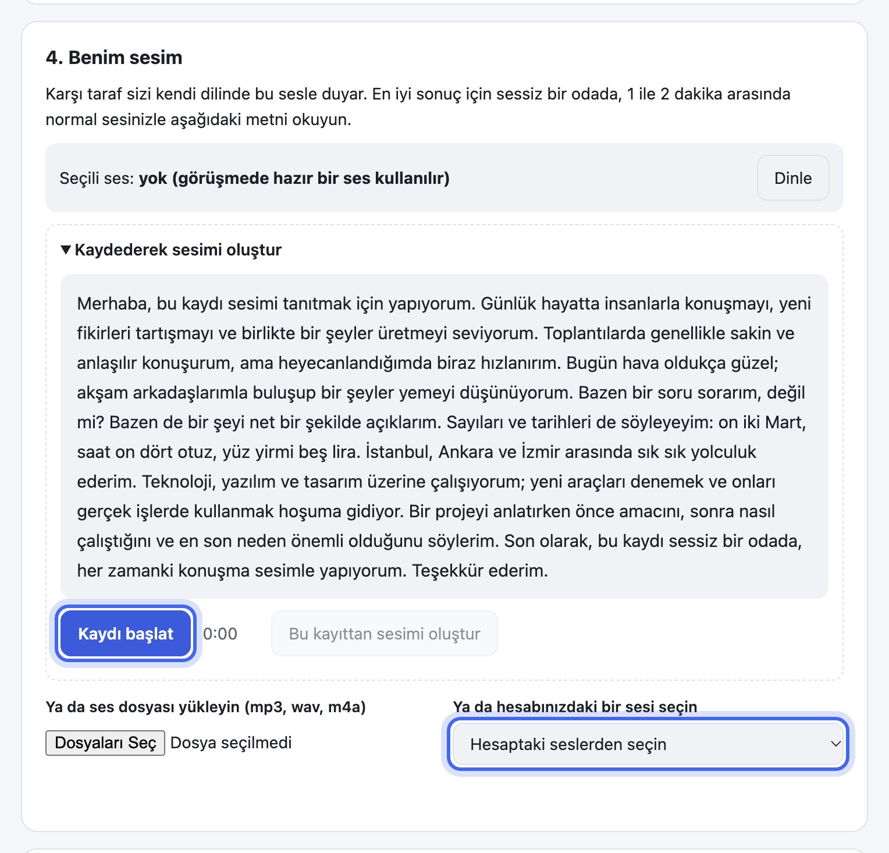

## 8. Çeviri: ücretsiz ya da Claude

**6. Çeviri** bölümünde **Çeviri modeli** olarak **Ücretsiz** seç. Anahtar gerekmez: çeviriyi Chrome'un kendi çevirmeni yapar ve ilk seferde kendini hazırlar ("Ücretsiz çeviri hazır.").

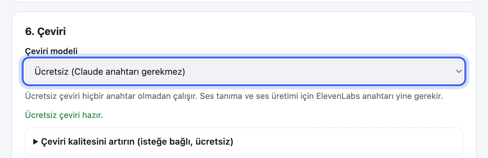

- **Daha iyi ücretsiz kalite:** **Çeviri kalitesini artırın** bölümünü aç, [DeepL API Free](https://www.deepl.com/pro-api), [Mistral](https://console.mistral.ai) ya da [Groq](https://console.groq.com/keys) üzerinden ücretsiz bir anahtar ekle. Eklenti yanıt veren en iyisini kullanır, kotası biteni kendisi atlar. Mistral'in ücretsiz planı metinleri varsayılan olarak model eğitiminde kullanır; konsoldaki gizlilik (Privacy) ayarından kapat.
- **Claude:** bir Claude modeli seç, [Claude Console › API keys](https://platform.claude.com/settings/keys) sayfasından aldığın Anthropic anahtarını **1. API anahtarları** bölümüne yapıştır. Hesapta kredi olmalı.

## 9. Görüşmede başlat

Bir Google Meet görüşmesine gir, eklentinin simgesine tıkla, modları seç ve **Çeviriyi başlat** düğmesine bas (kısayol: Alt + Shift + T).

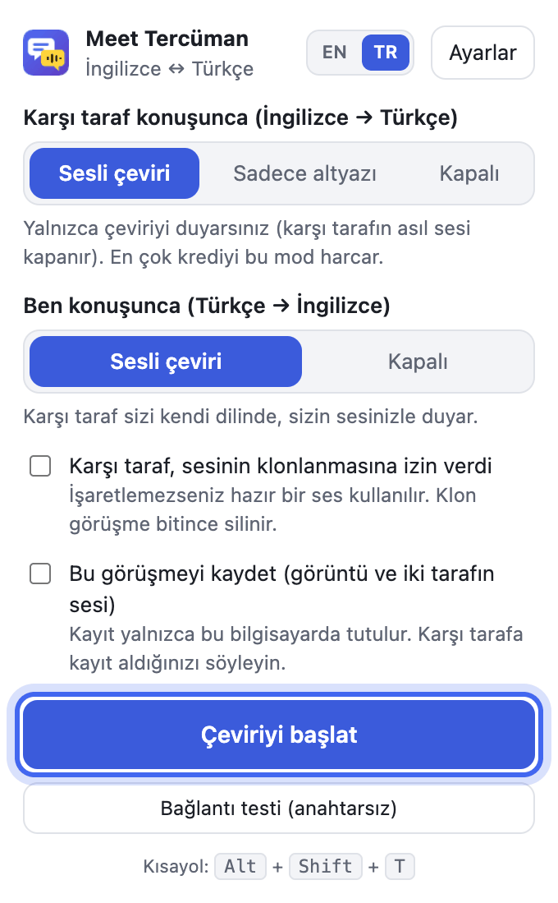

Modları krediyi düşünerek seç:

| Karşı taraf konuşunca | Ne olur | ElevenLabs kredisi |
| --- | --- | --- |
| **Sesli çeviri** | Karşı tarafı Türkçe sesli duyarsın | En çok bunu harcar |
| **Sadece altyazı** | Ses üretilmez: karşı tarafı kendi sesiyle duyarsın, çevirisi yazıyla çıkar | Çok daha az harcar |
| **Kapalı** | Çeviri yok, karşı tarafı kendi sesiyle duyarsın | Harcamaz |

| Ben konuşunca | Ne olur | ElevenLabs kredisi |
| --- | --- | --- |
| **Sesli çeviri** | Seni İngilizce, senin sesinle duyarlar | Harcar |
| **Kapalı** | Gerçek sesini duyarlar | Harcamaz |

- Karşı taraf izin verdiyse **Karşı taraf, sesinin klonlanmasına izin verdi** kutusunu işaretle: yaklaşık 45 saniye konuşmasından sonra çeviriyi onun sesine yakın bir sesle duyarsın. Klon görüşme bitince silinir.
- **Bu görüşmeyi kaydet** kutusu Meet sekmesinin görüntüsünü ve iki tarafın sesini bu bilgisayara MP4 olarak kaydeder. Karşı tarafa söyle.
- Meet sekmesi eklentiyi kurmadan önce açıksa sekmeyi bir kez yenile (F5).

## 10. Konuş

Meet penceresinin sol altında küçük bir **Meet Tercüman** düğmesi çıkar. Tıklayınca panel açılır: iki tarafın cümleleri iki dilde, gecikme ve görüşmenin şimdiye kadar harcadığı. Karşı tarafın çevirisi Meet penceresinin altında film altyazısı gibi de görünür. Görüşmeden çıkınca çeviri kendiliğinden durur.

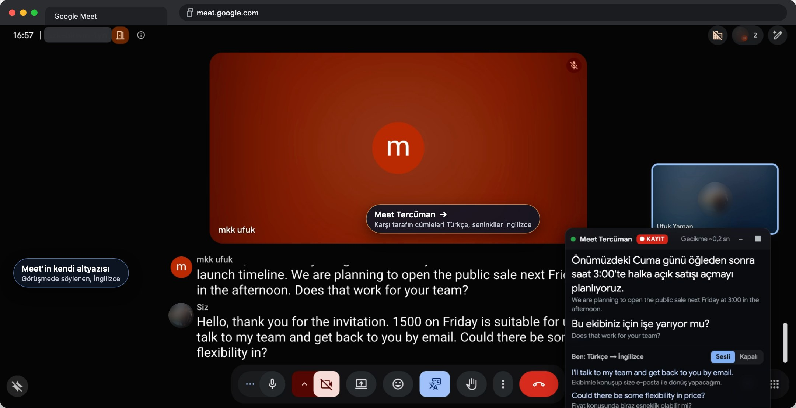

---

## Tek başına dene

1. Bilgisayarda Meet'te yeni bir toplantı aç, kulaklığı tak ve eklentiyi başlat.
2. Telefonla aynı toplantıya katıl. Telefonun sesini kıs ya da telefona ayrı bir kulaklık tak.
3. Telefona İngilizce konuş ya da telefonda İngilizce bir video aç: bilgisayarda Türkçesini duyarsın.
4. Bilgisayarın mikrofonuna Türkçe konuş: telefonda İngilizcesini duyarsın.

Aynı bilgisayardaki iki Meet katılımcısı birbirinin sesini bozar, ikinci bir cihaz kullan.

## Kredi tasarrufu

- **Sadece altyazı** modu ses üretmez, maliyetin en büyük kısmı ortadan kalkar.
- Meet'te mikrofonun uzun süre kapalıysa senin tarafının ses tanıması kendiliğinden durur.
- Görüşmeden çıkınca çeviri 30 saniye içinde kendiliğinden durur. Aynı sekmede Meet'ten çıkınca ya da sekmeyi kapatınca hemen durur.
- Panel, görüşme boyunca harcanan dakikayı, karakteri ve tahmini tutarı gösterir.

## Sorun giderme

| Belirti | Çözüm |
| --- | --- |
| "Manifest dosyası eksik veya okunamıyor" | Yanlış klasör seçilmiş. İçinde manifest.json olan klasörü seç: ZIP'ten çıkan meet-interpreter klasörü, kaynaktan derlediysen dist klasörü |
| "Meet sekmesini bir kez yenileyin (F5) ve tekrar deneyin." | Eklenti, sekme açıldıktan sonra kurulmuş. F5'e bas |
| "Eklentinin mikrofon izni yok." | Ayarlar, **Mikrofon iznini ver** |
| Karşı taraf beni duymuyor | Meet'te mikrofonun açık mı? Küçük düğmede ünlem varsa paneli aç ve uyarıyı oku. **Test sesi gönder** ile dene |
| Kendi çevirimi geri duyuyorum | Kulaklık kullan ya da ayarlarda **Hoparlör modu**nu aç |
| Gecikme fazla | Çeviri modeli olarak Claude Haiku 5.5 seç, **Konuşma bitti sayılması için sessizlik** ayarını 0,5 sn yap |
| Çeviri kendiliğinden durdu | Panel açık kalır ve nedenini yazar, örneğin ElevenLabs kotası doldu. Sorunu giderince eklentinin simgesinden yeniden başlat |

## Güncelleme

Yeni sürümün ZIP'ini indir, meet-interpreter klasörünün içini yeni ZIP'tekilerle değiştir ve `chrome://extensions` sayfasında eklentinin kartındaki yenile düğmesine bas. Ayarların ve sesin yerinde kalır.

## Kaynaktan derle

```bash
git clone https://github.com/UfukNode/meet-interpreter.git
cd meet-interpreter
npm install
npm run build
```

Sonra 3. adımda `dist` klasörünü seç. Windows'ta WSL içinde derle ([rehber](https://x.com/UfukDegen/status/1944066889346429338)).
